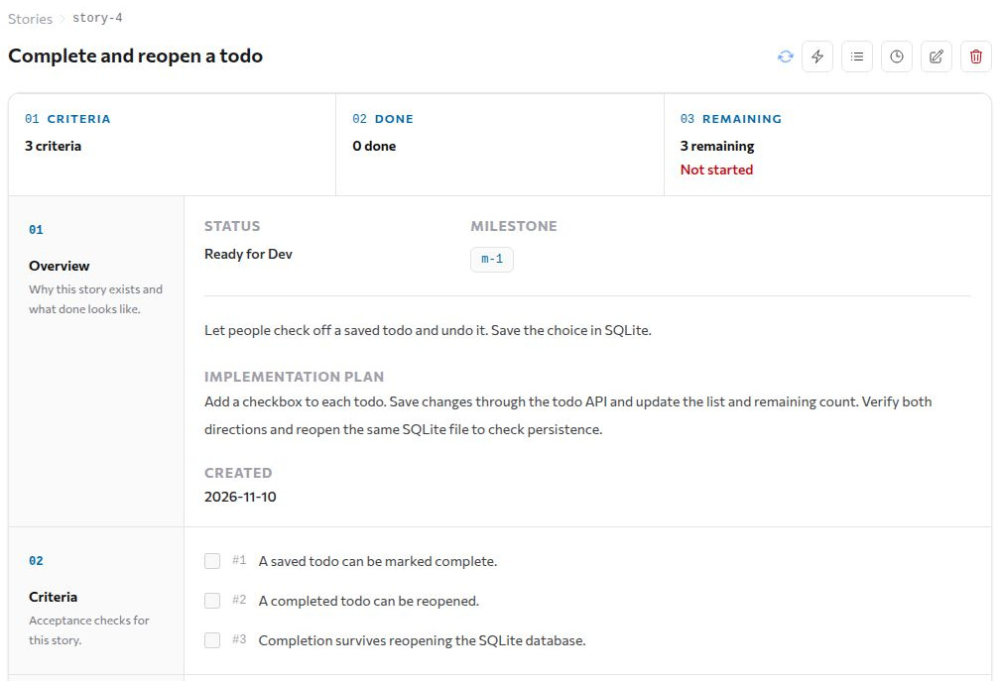

# S.E.E.

**Plan what comes next. Know what happened.**

Building software with agents can leave plans, decisions, and results scattered across chats. S.E.E. keeps your stories, workflows, and run history in one local workspace.

## Keep context between conversations

Keep objectives, stories, milestones, docs, and decisions with the project. Connect your agent through MCP to work with the same records.

## Set up the steps

Choose the commands and inputs for each step. Save the workflow to run it again for similar work.

## Review each attempt

Inspect step activity, process logs, and check results. Compare the output with the story's acceptance criteria before recording verified changes.

[See the feature walkthrough](https://workwithsee.com/features/).

## Try the Linux beta

[Download S.E.E. for Linux x86_64](https://github.com/workwithsee/releases/releases/tag/v1.0.7437). The release includes a Debian package, a portable bundle, checksums, and installation instructions. Downloads require no signup or GitHub account. Updates are manual.

Windows and macOS downloads are not available yet. The application source is private. Please don't share the beta downloads.

Visit [workwithsee.com](https://workwithsee.com/) for more about S.E.E., or browse the [official Library](https://github.com/workwithsee/library) for workflows, prompts, skills, and schemas.
